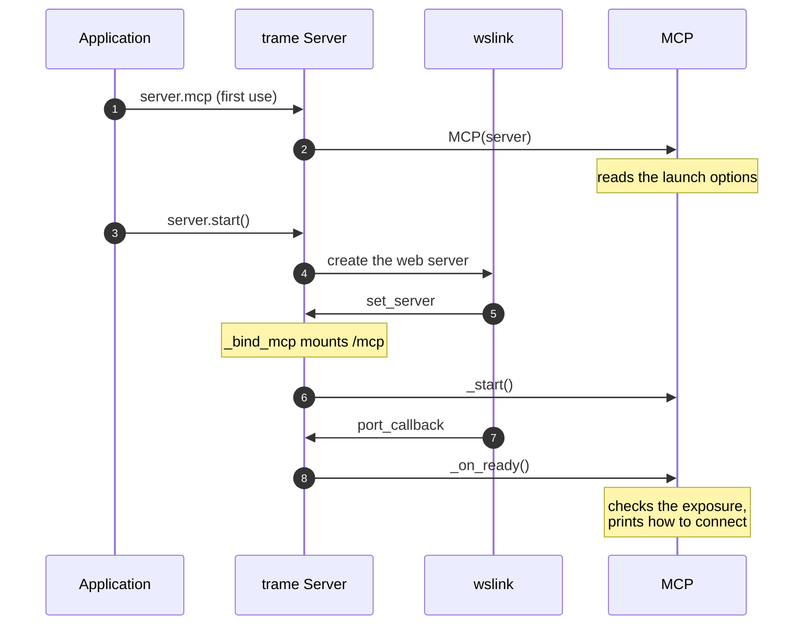
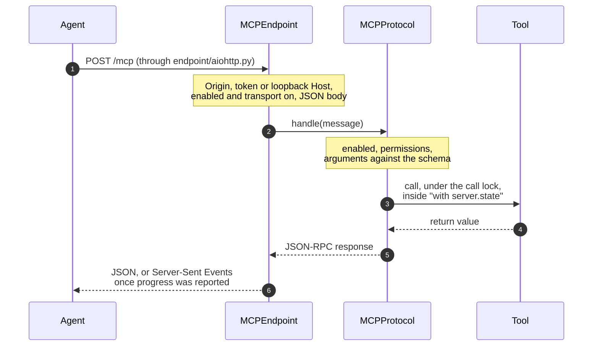

# How `trame_server.mcp` works

This package lets agents use a running trame app through MCP (Model Context
Protocol). This document explains its implementation, for the people and
coding agents who change it. What applications write, and why the API looks
the way it does, is in the **Agents (MCP)** guide of the trame documentation
(`docs/vitepress/guide/mcp/index.md` in
[Kitware/trame](https://github.com/Kitware/trame)). Module docstrings have
the details.

## What it serves

`server.mcp`, an instance of `MCP`, is the MCP server of a trame server.
Agents get:

- **Tools, resources and prompts** the application declares, with
  `@server.mcp.tool`, `server.mcp.resource(uri)` and `@server.mcp.prompt`, or
  the same decorators on a component's methods.
- **Objects**: instances of classes that inherit `MCPExposable` (from
  trame-common) and declare what agents see, such as components and
  trame-dataclass models. The app exposes objects under names
  (`server.mcp.expose_object()`, `component.mcp_expose()`), and agents reach
  further objects through their properties. A `state` object has the state
  keys the app exposes (`state.mcp_expose()`) as properties. Six generic
  tools, the *object tools*, work on all objects.

Nothing is served until `mcp.enabled` is True. Agents in other processes
connect through a *transport*: the only one is HTTP, at `/mcp` on the trame
web server's port. Agents inside the app's process use
`server.mcp.client()`, under the same rules.

## Package map

| Module | Contents |
| --- | --- |
| `core.py` | `MCP`: its options, the registries of tools, resources and prompts, and its life cycle |
| `cli.py` | The launch flags (`--mcp`, ...) and environment variables, read into a `LaunchOptions` |
| `endpoint/core.py` | `MCPEndpoint`, the HTTP endpoint, independent of any web server: it takes an `HTTPRequest` and returns an `HTTPResponse`. `HTTPTransport` holds its options (`server.mcp.http`) |
| `endpoint/aiohttp.py` | Serves `MCPEndpoint` on aiohttp, trame's default web server |
| `protocol.py` | `MCPProtocol`: the JSON-RPC dispatch, independent of the transport |
| `client.py` | `MCPClient`, the client for agents inside the process |
| `objects.py` | `ObjectLayer`: what agents reach, and the object tools |
| `typeinfo.py` | What agents see of a class, and type names |
| `schema.py` | JSON Schemas from type hints, and validation of what agents send |
| `budget.py` | Keeps replies under `mcp.max_response_tokens` |
| `content.py` | Turns return values into MCP content |
| `permissions.py` | Capabilities the people running the app can deny agents |
| `progress.py` | Progress notifications |
| `call_log.py` | The log of what agents call (`--mcp-log`) |

trame-common holds the declaration side and knows nothing about serving: the
decorators (`trame_common.decorators.mcp`) and `MCPExposable`
(`trame_common.obj.mcp`). `MCPExposable` stores what a class declares as
plain data, and gives each instance a process-wide id, `_id` (`"0x1"`,
`"0x2"`, ...). Types of classes adapt it through its `_mcp_*` hooks:
components ask to be held weakly (`_mcp_hold_weakly`), and trame-dataclass
models give their fields, their constructor, and `_mcp_settle()`, which
waits for the work a change starts.

## Creation and life cycle

- **Creation.** `server.mcp` is created on first use, and reads the launch
  options then. Until the server starts, they win over what the app assigns,
  which only sets defaults. The flags that withhold something (`--no-mcp`,
  `--no-mcp-transport`, `--mcp-deny`) hold for the whole run.
- **Mounting.** Once wslink has created its web server (`set_server`),
  `Server._bind_mcp` mounts `/mcp` with `endpoint/aiohttp.py`, even if
  `server.mcp` doesn't
  exist or isn't enabled yet: aiohttp freezes its routes when it starts. The
  endpoint answers 503 until access is on. wslink's other backends
  (`generic`, `jupyter`, `tornado`) give trame no HTTP server to mount on.
- **Start.** `MCP._start()` runs when the server binds its port. From then
  on, launch options no longer override the app. When the server listens
  beyond loopback, it also generates an HTTP token.
- **Ready.** Once the port is known (`port_callback`), `MCP._on_ready()` logs
  likely exposure
  mistakes (`ObjectLayer.audit`), and prints how to connect if access is on.

An `MCP` created after the server started runs `_start()` and `_on_ready()`
from its constructor.

**Child servers** (`server.create_child_server()`) share their root's MCP
server. As for `State` and `Controller`, a child's `server.mcp` is an `MCP`
built on its parent's, `MCP(server, internal=parent.mcp)`, which takes every
attribute from it through `share()`, except the translator: a child's object
names get its prefix, like its state keys. Values that aren't containers,
such as `enabled`, live in an `_MCPShared` instance, since a plain attribute
can't be shared by reference.

## Life of a request

Two things to know first:

- **Protocol revisions.** A client of MCP 2026-07-28 names its revision in
  each request's `_meta`, and has no session. Clients of earlier revisions
  open with `initialize`, and get a session id. Both are served.
- **The call lock.** Agent calls run one at a time: `MCPProtocol` holds a
  lock around each, unless the tool is marked `concurrent` or
  `mcp.concurrent_calls` is set.

An agent calls a tool over HTTP:

- `MCPEndpoint` checks the request before reading its body. The docstring of
  `endpoint/core.py` gives the reason for each check.
- `MCPProtocol._execute` runs every tool call. It validates the arguments
  (`schema.py`). A parameter typed with an object class receives an object
  id from the agent, which it replaces with the object.
- `with server.state:` flushes what the tool changed. An HTTP request never
  triggers a flush by itself, so without it, the changes would neither reach
  browsers nor run `@state.change` reactions.
- A request is cancelled when its client disconnects or sends
  `notifications/cancelled`.
- `MCPClient` hands its requests to `MCPProtocol.handle()` directly, so every
  rule after the HTTP checks applies to agents inside the process too.

## The object layer (`objects.py`)

**Exposure.** A name holds what it exposes in one of three ways
(`SourceType`): strongly, weakly (components, so that exposing one doesn't
keep it alive), or as a function returning the object, called on every
request.

**The graph.** For each call, `ObjectLayer._graph()` computes what agents
reach. It starts from the named objects and follows the properties agents
see that hold objects, inside lists, tuples, sets and dict values. The resulting
`Graph` maps each id to `(object, writable)`. It isn't cached, so it always
matches what the app holds, with nothing to invalidate; its cost grows with
what is reachable.

**Read-only.** A name exposed with `read_only=True` lets agents read what it
reaches but not change it. An object is writable when a writable path
reaches it. Reached only through read-only names, it can be read and run its
read-only methods, and only read-only callables can take it.

**Types.** `typeinfo.py` turns what trame-common stores about a class into
what agents see, and gives each type a name unique in the app. Members whose
permissions are denied are left out.

**The object tools** are added on the first exposure, so objects coming and
going never change the tool list:

| Tool | Does |
| --- | --- |
| `object_list` | Lists the names, paged |
| `object_types` | Indexes the types, or describes types and members |
| `object_get` | Reads an object, and the objects up to `depth` references away |
| `object_update` | Writes properties, after validating every value |
| `object_call` | Calls a method. It takes the call lock itself, so the method's own `concurrent` option decides |
| `object_batch` | Validates every step, then runs them under one lock |

**Replies** are `{"result", "objects", "more"}`: `result` refers to objects
by id, and `objects` holds each object read, once. `budget.py` keeps a reply
under `max_response_tokens` by leaving out the objects farthest from what was
read first.
`more` lists what was cut, with the call that returns it.

**Settling.** After a call or an update, the layer awaits the object's
`_mcp_settle()`, so that the reply includes what the change derived.

## Design decisions to keep

- `MCPEndpoint` stays independent of the web server, so a host can serve it
  on its own.
- Security needs no configuration on one machine: the `Origin` check stops
  other web pages, a token is required unless the `Host` is loopback (which
  defeats DNS rebinding), the JSON body forces a CORS preflight that is never
  granted, and listening beyond loopback generates a token.
- Clients are never told the tool list changed (`listChanged: false`). It
  changes only when the app adds or removes a tool, or a permission changes,
  and a call to a tool no longer offered is refused with the reason.
- Calls run one at a time by default, and each tool call flushes the state.
- Replies stay under `max_response_tokens`, and what is cut says how to get
  it.
- Nothing is served until `enabled`, and the person running the app decides
  through the launch flags.
- A `--mcp-deny` name the app doesn't declare refuses every call, so that a
  typo can't leave something allowed.

## Where to change what

| To | Change |
| --- | --- |
| Add a launch flag | `cli.py` (`add_arguments`, `LaunchOptions`, `to_launch_options`), then apply it in `MCP._apply_launch_options` |
| Add an option to `server.mcp` | A field in `_MCPShared`, and a property on `MCP` |
| Serve on another web server | A module in `endpoint/` that turns its requests into `HTTPRequest`s for `MCPEndpoint.post`, mounted from `Server._bind_mcp` |
| Add a transport | Its name in `TRANSPORTS` (`core.py`), and code feeding `MCPProtocol.handle()`, as `client.py` does |
| Serve a new MCP method | The handler tables in `MCPProtocol.__init__` |
| Change the object tools or their replies | `objects.py` (their descriptions are its `*_DESCRIPTION` constants), and `budget.py` |
| Support a new type in signatures | `schema.py`: `type_to_schema`, `validate`, `from_json` |
| Change what agents see of a class | `typeinfo.py` |
